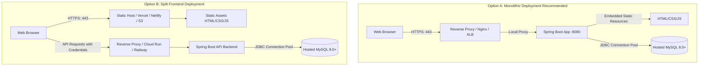

# Volunteer Hub: Production Deployment & Infrastructure Guide

This guide provides an end-to-end operational roadmap for deploying the **Volunteer Hub and Performance Tracking System** to production cloud infrastructure. It details architecture topologies, hosting distinctions, cloud database setup, secret management, HTTPS, CORS, Flyway lifecycle, and backup strategies.

---

## 1. Hosting Architecture: Monolith vs. Split Frontend

An essential architectural understanding is the difference between static frontend hosting and dynamic Java server hosting:



### 1.1 Option A: Unified Spring Boot Hosting (Recommended)
Spring Boot embeds Tomcat and serves all HTML, CSS, JavaScript, and SVG assets directly from `src/main/resources/static/`.
- **Advantages:** Zero CORS configuration required, same-origin session cookies (`JSESSIONID`) work out of the box with `SameSite=Strict`, single server process, zero deployment synchronization issues.
- **Suitable Hosts:** AWS EC2, AWS Elastic Beanstalk, Railway, Render, Fly.io, DigitalOcean App Platform, Google Cloud Run.

### 1.2 Option B: Split Architecture (Static Host + API Host)
The frontend (`.html`, `.css`, `.js`) is deployed to a static host (GitHub Pages, Netlify, Vercel, AWS S3/CloudFront), while the Spring Boot backend runs on a container or VM.
- **Critical Requirement:** **Static hosts cannot run Java, Spring Boot, or MySQL.** They can only serve static files over HTTP.
- **Prerequisites for Split Architecture:**
  1. The API backend must be accessible over public HTTPS (e.g., `https://api.volunteerhub.org`).
  2. The frontend JavaScript (`api.js`) must point its `apiFetch` baseURL to the remote API.
  3. **CORS must be enabled** in Spring Security (`app.cors.allowed-origins=https://volunteerhub.org`).
  4. Cookies must allow cross-site submission: `server.servlet.session.cookie.same-site=none` and `server.servlet.session.cookie.secure=true`.

---

## 2. Hosted MySQL Database Setup

The application requires **MySQL 8.0 or 8.4** with `utf8mb4` encoding.

### 2.1 Managed Cloud Database Providers
- **AWS RDS for MySQL:** Enterprise grade, automatic Multi-AZ replication, daily snapshots.
- **Aiven for MySQL:** Multi-cloud, developer-friendly, automated backups and SSL certificates.
- **Railway / Render Managed MySQL:** Simple setup for small-to-medium deployments with built-in connection strings.
- **DigitalOcean Managed Databases:** Cost-effective with built-in connection pooling and firewalls.

### 2.2 Initializing the Production Database
1. Connect to your hosted MySQL instance using administrative credentials via MySQL Workbench or CLI:
   ```bash
   mysql -h your-db-host.rds.amazonaws.com -u admin -p
   ```
2. Create the production database schema and a dedicated non-root application user:
   ```sql
   CREATE DATABASE volunteer_hub
       CHARACTER SET utf8mb4
       COLLATE utf8mb4_unicode_ci;

   CREATE USER 'vh_prod_user'@'%' IDENTIFIED BY 'StrongRandomProductionPassword_2026!';
   GRANT ALL PRIVILEGES ON volunteer_hub.* TO 'vh_prod_user'@'%';
   FLUSH PRIVILEGES;
   ```
3. Restrict incoming database connections using cloud Security Groups (e.g., AWS Security Group permitting port 3306 only from the Spring Boot application's security group).

---

## 3. Environment Variables & Secret Management

In production, **never commit database passwords or API keys to Git**. The production profile (`application-prod.properties`) strictly requires environment variables without local fallbacks.

### 3.1 Required Production Environment Variables

| Variable | Description | Example Production Value |
|---|---|---|
| `SPRING_PROFILES_ACTIVE` | Active Spring profile | `prod` |
| `DB_URL` | JDBC URL with SSL enabled | `jdbc:mysql://db.example.com:3306/volunteer_hub?useSSL=true&requireSSL=true&serverTimezone=UTC` |
| `DB_USERNAME` | Application MySQL user | `vh_prod_user` |
| `DB_PASSWORD` | Cryptographically random password | `StrongRandomProductionPassword_2026!` |
| `SERVER_PORT` | HTTP port | `8080` (or injected by cloud provider `$PORT`) |
| `FLYWAY_TARGET` | Flyway target migration version | `1` (Schema only; bypasses dev sample data) |
| `MAIL_ENABLED` | Production email dispatch | `true` |
| `APP_CORS_ALLOWED_ORIGINS` | Permitted frontend origins (if split) | `https://volunteerhub.org` |

### 3.2 Secret Injection Methods
- **AWS Secrets Manager / Systems Manager Parameter Store:** Fetch secrets at container launch or inject into ECS task definitions.
- **Docker Compose / Swarm:** Use `docker secrets` or an untracked `.env.production` file with file permissions `600`.
- **Platform as a Service (Railway, Render, Heroku):** Enter keys in the web dashboard **Environment Variables** panel; keys are encrypted at rest and injected into the container environment.

---

## 4. Flyway Migrations in Production

### 4.1 Schema Migration Isolation
The repository contains two Flyway scripts:
- `V1__create_schema.sql`: Full DDL schema (11 tables, indexes, constraints).
- `V2__dev_sample_data.sql`: Development seed accounts and mock events.

**Safety Rule:** In production, you must **never apply developer sample data** to avoid seeding test accounts (`alice@example.com`, etc.).
In `application-prod.properties`:
```properties
spring.flyway.target=1
```
Setting `target=1` instructs Flyway to apply `V1__create_schema.sql` and ignore `V2__dev_sample_data.sql`.

### 4.2 Seed First Production Administrator Account
Since sample data is excluded, create the initial platform administrator securely via an SQL script run once in MySQL Workbench:
```sql
-- Insert initial system administrator
INSERT INTO volunteer_hub.users (email, password_hash, role, status, created_at)
VALUES (
    'admin@yourdomain.org',
    -- BCrypt hash for initial temporary password (change immediately upon login)
    '$2a$10$YourInitialBCryptHashGeneratedSecurely',
    'ADMIN',
    'ACTIVE',
    NOW()
);
```

---

## 5. HTTPS, TLS Termination & Cookie Security

### 5.1 TLS Termination with Reverse Proxy (Nginx)
Spring Boot should run behind a reverse proxy that terminates TLS (HTTPS on port 443) and forwards traffic to Spring Boot on port 8080.

Example Nginx configuration (`/etc/nginx/sites-available/volunteerhub.conf`):
```nginx
server {
    listen 80;
    server_name volunteerhub.org www.volunteerhub.org;
    return 301 https://$host$request_uri;
}

server {
    listen 443 ssl http2;
    server_name volunteerhub.org www.volunteerhub.org;

    ssl_certificate /etc/letsencrypt/live/volunteerhub.org/fullchain.pem;
    ssl_certificate_key /etc/letsencrypt/live/volunteerhub.org/privkey.pem;
    ssl_protocols TLSv1.2 TLSv1.3;
    ssl_ciphers HIGH:!aNULL:!MD5;

    # HSTS (Strict-Transport-Security)
    add_header Strict-Transport-Security "max-age=31536000; includeSubDomains" always;
    add_header X-Content-Type-Options "nosniff" always;
    add_header X-Frame-Options "DENY" always;

    location / {
        proxy_pass http://127.0.0.1:8080;
        proxy_set_header Host $host;
        proxy_set_header X-Real-IP $remote_addr;
        proxy_set_header X-Forwarded-For $proxy_add_x_forwarded_for;
        proxy_set_header X-Forwarded-Proto $scheme;
    }
}
```

### 5.2 Session Cookie Settings (`application-prod.properties`)
```properties
# Enforce HTTPS-only cookie transmission
server.servlet.session.cookie.secure=true
server.servlet.session.cookie.http-only=true
server.servlet.session.cookie.same-site=strict

# Inform Spring Boot to trust reverse proxy headers (X-Forwarded-Proto)
server.forward-headers-strategy=native
```

---

## 6. How Default Admin Credentials Must Be Changed

If `V2__dev_sample_data.sql` was accidentally executed or default credentials exist:
1. Log in immediately using the web browser at `https://yourdomain.org/login.html`.
2. Navigate to **Profile** -> **Change Password**.
3. Supply current password and enter a 12+ character complex passphrase with letters, numbers, and symbols.
4. Alternatively, update the hash directly in MySQL:
   ```sql
   UPDATE volunteer_hub.users
   SET password_hash = '$2a$10$YourNewStrongBCryptHash'
   WHERE email = 'admin@volunteerhub.org';
   ```

---

## 7. Logging & System Monitoring

In production, console logging is reduced to prevent log flooding while maintaining visibility over exceptions.
- **Log Levels:** `root=WARN`, `com.volunteerhub=INFO`.
- **Log Aggregation:** Route stdout/stderr to CloudWatch Logs, Papertrail, Datadog, or Grafana Loki.
- **Application Health Check:** Use `GET /api/health` with an automated uptime monitor (UptimeRobot, AWS Route 53 Health Checks, Better Uptime) alerting on non-200 responses.

---

## 8. Backup & Disaster Recovery Strategy

1. **Daily Automated Logical Backups (`mysqldump`):**
   ```bash
   mysqldump -h $DB_HOST -u $DB_USERNAME -p$DB_PASSWORD \
     --single-transaction --quick --routines --triggers \
     volunteer_hub | gzip > /backups/volunteer_hub_$(date +\%F).sql.gz
   ```
2. **Offsite Backup Storage:** Upload compressed archives to an Amazon S3 bucket with **Object Lock (WORM)** and lifecycle retention rules (retain 30 days).
3. **Point-in-Time Recovery (PITR):** Enable MySQL binary logging (`binlog`) with 7-day retention for transaction rollback recovery.

---

## 9. Cloud Free-Tier Limits & Practical Guidance

When deploying on free or low-cost cloud tiers (e.g., Render, Railway, AWS Free Tier):

| Constraint | Impact on Application | Mitigation Strategy |
|---|---|---|
| **RAM Limits (512 MB – 1 GB)** | JVM heap exhaustion during PDF generation | Configure JVM heap flags: `JAVA_OPTS="-Xms256m -Xmx512m -XX:+UseG1GC"`. |
| **Connection Caps (5 – 10 connections)** | HikariCP pool errors | Lower pool size in properties: `spring.datasource.hikari.maximum-pool-size=5`. |
| **Inactivity Sleeping (Cold Starts)** | 30–60 second latency on first request | Configure a ping monitor (e.g., cron or UptimeRobot) hitting `/api/health` every 10 minutes. |
| **Storage Limits (1 GB – 5 GB)** | Database growth over time | Purge old notifications and audit logs older than 180 days via a maintenance cron job. |

---

## 10. Summary Checklist for Production Launch

- [ ] MySQL database initialized with `utf8mb4` character set.
- [ ] Dedicated MySQL user created with non-default password.
- [ ] Production environment variables (`DB_URL`, `DB_USERNAME`, `DB_PASSWORD`, `SPRING_PROFILES_ACTIVE=prod`) set.
- [ ] `FLYWAY_TARGET=1` configured to isolate production from test sample data.
- [ ] Initial production administrator seeded with strong password.
- [ ] Reverse proxy (Nginx / ALB) configured with valid SSL/TLS certificate (HTTPS).
- [ ] `server.servlet.session.cookie.secure=true` verified in production profile.
- [ ] Uptime monitoring enabled on `/api/health`.
- [ ] Daily automated database backup schedule verified.
