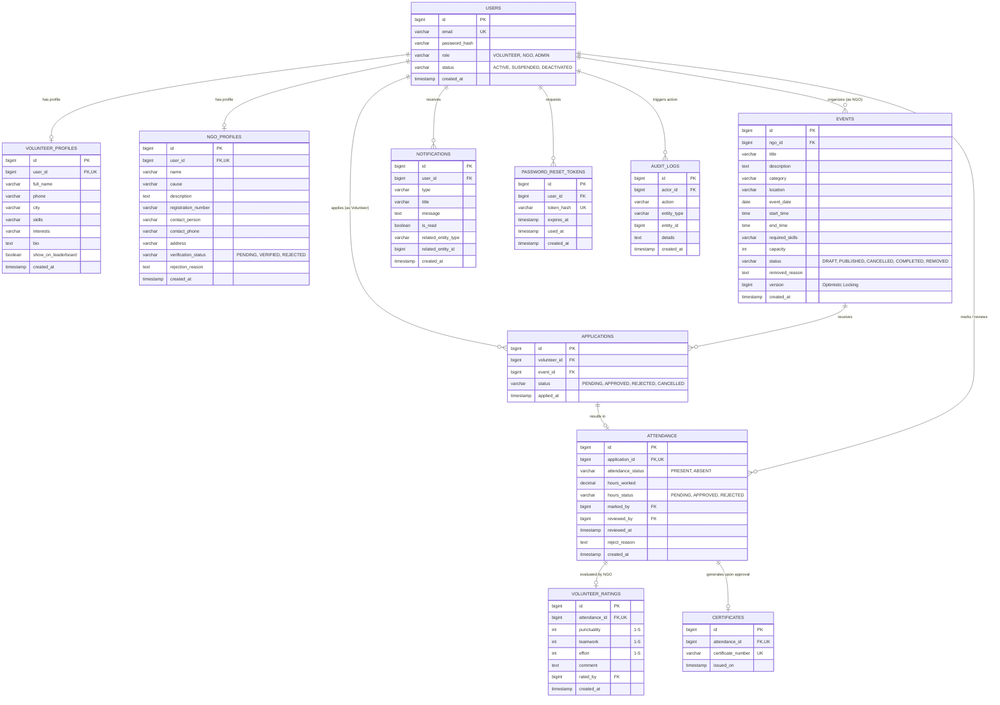

# Volunteer Hub: Entity-Relationship Diagram

This diagram visualizes the relational schema implemented in Flyway migrations (`V1__create_schema.sql`).

## Architectural Highlights
1. **Zero Redundant Columns**: Total hours, attendance rate %, average rating, performance score, and badge tiers are aggregated from trusted `attendance` and `volunteer_ratings` records at query time.
2. **Strict Foreign Keys**: Cascading deletions protect user isolation, while attendance and certificates maintain strict 1-to-1 relationships with their parent records.
3. **Optimistic Locking**: `events.version` safeguards concurrent event updates, complementing pessimistic locking (`PESSIMISTIC_WRITE`) used during slot reservations in Phase 3.
