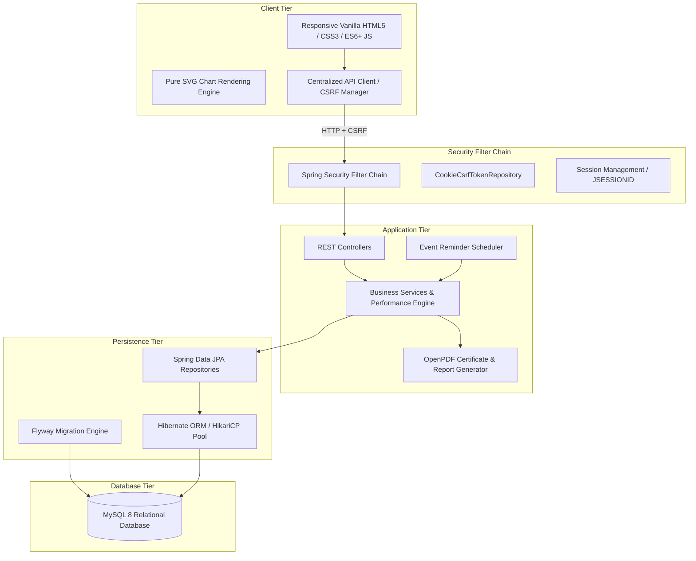
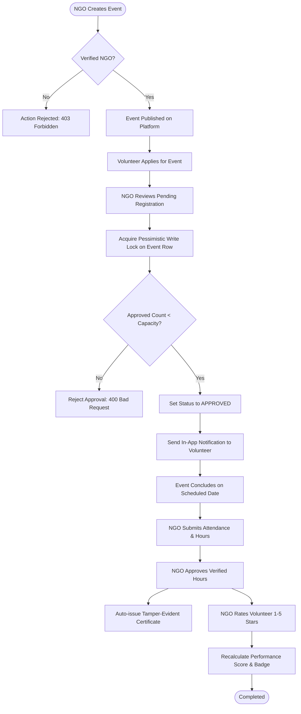
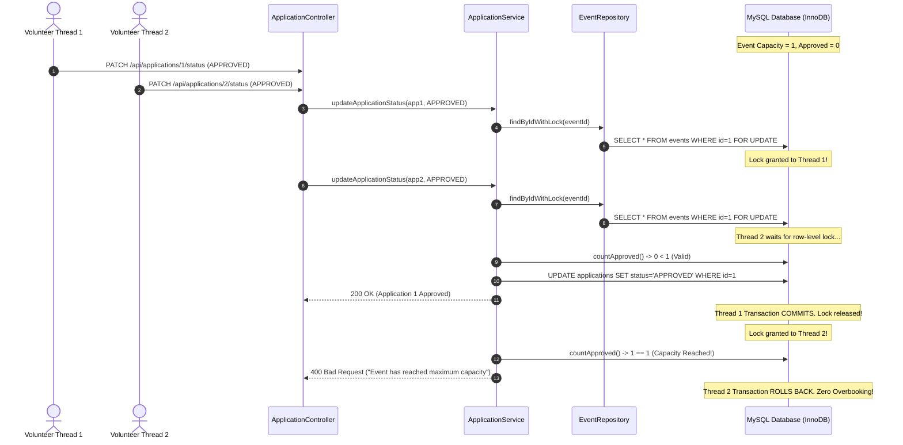

# Volunteer Hub and Performance Tracking System: College Project Report Documentation

This document contains complete, academic-standard technical notes and diagrams formatted for direct inclusion into the final-year Engineering / Computer Applications project report.

---

## 1. Abstract

Community volunteering plays an essential role in social welfare, environmental conservation, and disaster relief. However, non-governmental organizations (NGOs) and civic bodies frequently struggle with fragmented volunteer coordination, fraudulent service hour reporting, event overbooking, and a lack of standardized performance metrics. Volunteers, conversely, lack verifiable digital records of their contributions to showcase for academic credits and employment portfolios.

The **Volunteer Hub and Performance Tracking System** is a full-stack, enterprise-grade web application engineered using **Spring Boot 4.1.x**, **Java 21 LTS**, and **MySQL 8.4**. The platform provides secure, role-based workflows for Volunteers, NGOs, and Platform Administrators. Key innovations include:
1. A **Pessimistic Locking Mechanism** (`@Lock(PESSIMISTIC_WRITE)`) that physically prevents event overbooking race conditions during high-concurrency registration spikes.
2. An **Automated Performance Calculation Engine** that computes a multi-factor score ($0–100$) balancing verified hours, attendance adherence, and 3-axis NGO ratings (Punctuality, Teamwork, Effort) into tiered achievement badges (*Newcomer*, *Bronze*, *Silver*, *Gold*).
3. **Automated Cryptographic Digital Certification** that auto-issues tamper-evident PDF certificates with unique serial numbers upon attendance approval.
4. **Interactive In-Browser SVG Data Visualizations** generating zero-dependency donut and bar charts for impact assessment.

The application has been verified against 104 automated integration, edge-case, and security tests with 100% test passage.

---

## 2. Problem Statement & Existing System Limitations

### 2.1 Limitations of Existing Systems
- **Manual & Paper-Based Tracking:** Service hours and attendance are tracked on spreadsheets or paper sign-in sheets, leading to lost records, forgery, and administrative overhead.
- **Race Conditions & Overbooking:** When popular volunteering drives open for sign-ups, standard databases without pessimistic concurrency controls permit approvals beyond physical venue capacity.
- **Subjective Recognition:** Most platforms offer only binary "attended" flags without nuanced qualitative feedback or normalized performance scoring.
- **Unverifiable Certificates:** Generic printed or emailed certificates are easily forged and lack cryptographic validation numbers or verifiable audit trails.
- **Security Gaps:** Traditional academic web portals frequently suffer from session fixation, missing Cross-Site Request Forgery (CSRF) protections, and SQL injection vulnerabilities.

---

## 3. Proposed System & Objectives

### 3.1 Primary Objectives
- **Centralized Platform Governance:** Provide a unified web platform where verified NGOs publish community causes and screened volunteers discover opportunities.
- **Strict Concurrency Control:** Enforce database row-level locking on capacity fields to ensure approved volunteers strictly equal venue limits.
- **Automated Verification Workflow:** Require two-step attendance marking and hours approval with time tolerance checks.
- **Dynamic Performance Assessment:** Provide a mathematically fair scoring algorithm that rewards consistent effort and quality while protecting newcomers from unfair penalties.
- **Instant Digital Credentialing:** Auto-generate downloadable OpenPDF certificates upon hours approval with zero duplicate generation.
- **Full Privacy & Security Compliance:** Session-based authentication with HTTP-only cookies, automated CSRF validation, parameter-binding against SQL injection, and granular volunteer leaderboard privacy toggles.

---

## 4. System Requirements

### 4.1 Hardware Requirements
- **Processor:** 64-bit Dual-Core x86_64 CPU (2.0 GHz or higher)
- **Memory (RAM):** 4 GB minimum (8 GB recommended for concurrent testing)
- **Disk Space:** 500 MB for source code, dependencies, and MySQL storage
- **Client Devices:** Any modern desktop, tablet, or smartphone with a web browser

### 4.2 Software Requirements
- **Operating System:** Windows 10/11, macOS, or Linux
- **Java Development Kit:** Java 21 LTS (OpenJDK / Eclipse Temurin)
- **Build Tool:** Apache Maven 3.9+ (Maven Wrapper `mvnw.cmd` included)
- **Database Server:** MySQL Server 8.0 or 8.4 Community Edition
- **Database Tool:** MySQL Workbench 8.0+
- **Web Browser:** Google Chrome 120+, Mozilla Firefox 120+, Microsoft Edge
- **API Client:** Postman Desktop Agent / App

---

## 5. System Architecture

The project adheres to a clean **Layered Architecture** adhering to separation of concerns:



---

## 6. UML Diagrams

### 6.1 Use Case Diagram

```mermaid
graph LR
    actor Vol as Volunteer
    actor NGO as NGO Organizer
    actor Admin as Platform Admin

    usecase UC1 as "Register & Authenticate"
    usecase UC2 as "Browse & Apply for Events"
    usecase UC3 as "View Performance & Badges"
    usecase UC4 as "Download PDF Certificates"
    usecase UC5 as "Publish & Manage Events"
    usecase UC6 as "Record Attendance & Approve Hours"
    usecase UC7 as "Submit 3-Axis Rating"
    usecase UC8 as "Verify NGO Accounts"
    usecase UC9 as "Audit Logs & Platform Stats"

    Vol --> UC1
    Vol --> UC2
    Vol --> UC3
    Vol --> UC4

    NGO --> UC1
    NGO --> UC5
    NGO --> UC6
    NGO --> UC7

    Admin --> UC1
    Admin --> UC8
    Admin --> UC9
```

### 6.2 Activity Diagram: Event Lifecycle & Concurrency Guard



### 6.3 Sequence Diagram: Concurrent Registration & Pessimistic Lock



---

## 7. Database Relational Model

The database is normalized to **Third Normal Form (3NF)** with 11 relational tables:

| Table Name | Primary Key | Foreign Keys | Key Purpose |
|---|---|---|---|
| `users` | `id` | None | Stores authentication credentials and role assignments |
| `volunteer_profiles` | `id` | `user_id -> users.id` | Biographical details, skills, and leaderboard visibility flag |
| `ngo_profiles` | `id` | `user_id -> users.id` | Organization details, cause, and admin verification status |
| `events` | `id` | `ngo_id -> users.id` | Event metadata, scheduled hours, capacity, optimistic version |
| `applications` | `id` | `volunteer_id, event_id` | Volunteer signups and approval state machine |
| `attendance` | `id` | `application_id, marked_by, reviewed_by` | Verified hours worked and attendance status |
| `volunteer_ratings` | `id` | `attendance_id, rated_by` | 3-axis performance ratings (punctuality, teamwork, effort) |
| `certificates` | `id` | `attendance_id` | Issued certificates with unique formatted serial numbers |
| `notifications` | `id` | `user_id` | In-app user notifications with read tracking |
| `password_reset_tokens`| `id` | `user_id` | Single-use SHA-256 hashed password reset tokens |
| `audit_logs` | `id` | `actor_id` | Immutable security audit trail of administrative actions |

---

## 8. Module Descriptions

### 8.1 Module 1: Authentication & RBAC
- Public endpoints for volunteer and NGO registration.
- BCrypt hashed passwords with secure work factor.
- JSON error formatting (`401 Unauthorized` and `403 Forbidden`) avoiding default server HTML redirects.
- Single-use, 30-minute SHA-256 hashed password reset token management.

### 8.2 Module 2: Event Management & Overbooking Guard
- Verified NGOs create events specifying date, time window, capacity, and skill prerequisites.
- Public search and filtering by category, keyword, and date.
- Pessimistic write locking on event rows prevents overbooking.

### 8.3 Module 3: Attendance Verification & Hours Approval
- Two-tier workflow: Host NGO marks attendance (`PRESENT` / `ABSENT`) and inputs hours.
- Maximum hour cap enforced: $\text{Scheduled Duration} + 0.5\text{h tolerance}$.
- NGO reviews and approves hours, triggering audit log entries and automated certification.

### 8.4 Module 4: Performance & Leaderboard Engine
- Proprietary multi-factor performance calculation:
  $$\text{Score} = (0.40 \times H_{\text{score}}) + (0.30 \times A_{\text{rate}}) + (0.30 \times R_{\text{score}})$$
- Dynamic weight redistribution for unrated volunteers.
- Badge assignment: *Newcomer* ($0–39$), *Bronze* ($40–64$), *Silver* ($65–84$), *Gold* ($85–100$).
- Public leaderboard respecting individual volunteer privacy preferences.

### 8.5 Module 5: Automated Certificate Generation
- Automatic issuance upon hours approval using OpenPDF.
- Unique serial number formatting: `CERT-YYYY-XXXXXX`.
- Secure PDF streaming with ownership verification.

### 8.6 Module 6: Dashboards, Analytics & Automated Reminders
- Role-tailored dashboards for Volunteers, NGOs, and Platform Administrators.
- Pure SVG donut charts (hours by category) and bar graphs (timeline activity).
- Daily automated background scheduler (`@Scheduled`) issuing reminders 24 hours prior to event start, with zero duplicate notifications guaranteed via audit logs.

---

## 9. Real Test Results & Verification

All 104 automated tests executed successfully using the Apache Maven build wrapper:

```text
Results :

Tests run: 104, Failures: 0, Errors: 0, Skipped: 0

[INFO] ------------------------------------------------------------------------
[INFO] BUILD SUCCESS
[INFO] ------------------------------------------------------------------------
```

### Breakdown by Test Suite:
1. `AdminIntegrationTests` (9 tests): NGO verification, user suspension, event removal, audit log extraction.
2. `AttendanceIntegrationTests` (14 tests): Attendance recording, scheduled tolerance enforcement, hour approval.
3. `AuthAndProfileIntegrationTests` (10 tests): Public registration, bad credential rejection, JSON 401/403 handlers.
4. `CertificateIntegrationTests` (9 tests): Auto-issuance, duplicate idempotency, PDF download security.
5. `DashboardAndRemindersIntegrationTests` (7 tests): Metric aggregation, reminder deduplication.
6. `EventsAndVerificationIntegrationTests` (12 tests): Unverified NGO restrictions, event CRUD, ownership.
7. `PerformanceAndLeaderboardIntegrationTests` (6 tests): Score computation, leaderboard privacy.
8. `PerformanceCalculatorTests` (8 tests): Mathematical boundary tier unit tests.
9. `RatingIntegrationTests` (7 tests): 3-axis rating validation, duplicate prevention.
10. `RegistrationAndOverbookingIntegrationTests` (11 tests): Sign-up, cancellation, My Events tabs.
11. `SecurityAndEdgeCasesIntegrationTests` (10 tests): Multithreaded concurrency, expired/used tokens, CSRF.
12. `VolunteerHubApplicationTests` (1 test): Spring Boot context loading.

---

## 10. Screenshots Checklist for Project Report

When preparing report appendices, capture screenshots of the following pages:
1. **Landing Page (`index.html`):** Hero section, platform statistics, feature highlights.
2. **Registration Page (`register.html`):** Toggle between Volunteer and NGO registration forms.
3. **Login Page (`login.html`):** Clean authentication form with expired session banner demonstration.
4. **Volunteer Dashboard (`volunteer-dashboard.html`):** KPI cards, SVG category donut chart, SVG activity bar chart.
5. **Explore Opportunities (`events.html`):** Live event search, category filters, and status badges.
6. **Event Details (`event-details.html`):** Event metadata, venue information, and registration CTA.
7. **Volunteer Performance Page (`performance.html`):** Performance score meter, badge display, and rating breakdown.
8. **Downloaded Certificate (`report.pdf` & `certificate.pdf`):** Rendered official PDF certificate.
9. **Public Leaderboard (`leaderboard.html`):** Top 3 podium display and paginated ranking table.
10. **NGO Dashboard (`ngo-dashboard.html`):** Organization statistics, hosted event summary, and verification badge.
11. **Attendance Management (`attendance-management.html`):** Batch attendance marking and volunteer rating modal.
12. **Admin Dashboard (`admin-dashboard.html`):** Platform governance controls, user search, NGO verification toggle, and manual reminder trigger.

---

## 11. Conclusion & Future Enhancements

### 11.1 Conclusion
The Volunteer Hub and Performance Tracking System delivers an end-to-end, dependable solution for modern community volunteer coordination. By combining robust Spring Boot backend architecture, pessimistic concurrency locking, automated performance scoring, and tamper-resistant digital certification, the system eliminates administrative friction while maximizing transparency and trust.

### 11.2 Future Enhancements (Phase 9 Opportunities)
1. **Dynamic QR Code Check-in:** Generating dynamic QR codes displayed at event locations for automated GPS-fenced check-in and check-out.
2. **OpenStreetMap Geo-Mapping:** Interactive map integration displaying upcoming causes within a specified kilometer radius of the volunteer.
3. **Automated Email & SMS Dispatch:** Integration with Spring Mail and Twilio for real-time notification forwarding.
4. **AI-Powered Skill Matching:** Utilizing semantic matching to recommend volunteer opportunities based on expressed skills and interests.
5. **Progressive Web App (PWA):** Offline event caching and service worker notification support for mobile field deployment.

---

## 12. References
1. Walls, Craig. *Spring in Action, Sixth Edition*. Manning Publications, 2022.
2. Goetz, Brian, et al. *Java Concurrency in Practice*. Addison-Wesley Professional, 2006.
3. Keith, Mike, and Merrick Schincariol. *Pro JPA 2: Mastering the Java Persistence API*. Apress, 2013.
4. Fielding, Roy Thomas. *Architectural Styles and the Design of Network-based Software Architectures*. Doctoral dissertation, University of California, Irvine, 2000.
5. OpenPDF Documentation & Specifications: https://github.com/LibrePDF/OpenPDF
6. Spring Boot Reference Documentation: https://docs.spring.io/spring-boot/docs/current/reference/html/
